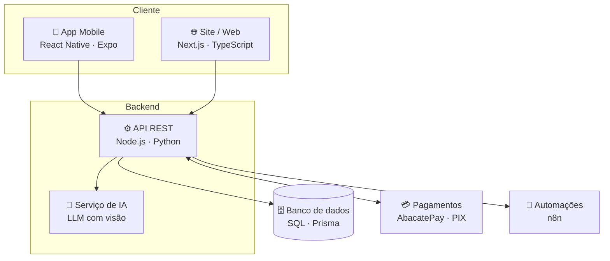

  

<h1 align="center">AeChefia</h1>

<b>SaaS de Gestão para Bares e Restaurantes</b>

> **Produto em produção, com clientes pagantes.** Plataforma multi-tenant que coloca a operação inteira de um estabelecimento — cardápio, mesas, comandas, cozinha e caixa — na palma da mão.
 

  
  
  

  🌐 <a href="https://www.aechefia.com.br"><b>aechefia.com.br</b></a> &nbsp;·&nbsp; 📱 Disponível na Google Play

> 🔒 **Este é um repositório-vitrine.** O AeChefia é um produto comercial privado — o código-fonte não é público por conter propriedade intelectual, regras de negócio e dados de clientes. Aqui eu documento a **arquitetura, as decisões técnicas e os desafios resolvidos**. Fico à disposição para apresentar o produto em detalhe em uma conversa.
 
---
 
## 🎯 O problema
 
Bares e restaurantes pequenos e médios operam no improviso: comanda de papel que some, pedido que chega errado na cozinha, caixa que não fecha no fim da noite. Os sistemas de gestão completos existentes são caros, complexos e exigem PC/Windows — inviáveis para o dono que quer resolver tudo pelo celular.
 
**O AeChefia resolve isso** com uma plataforma mobile-first, simples de configurar e acessível, que digitaliza toda a operação em um app só.
 
## ✨ Principais funcionalidades
 
- 📸 **Cardápio por foto com IA** — o dono fotografa o cardápio físico e um modelo de linguagem com visão extrai itens, preços e categorias automaticamente; o resultado é validado e revisado antes de publicar. Cardápio inteiro no ar em minutos, em vez de cadastro item por item.
- 📋 **Cardápio digital** — categorias, preços e promoções atualizados em tempo real.
- 🪑 **Gestão de mesas** — status de cada mesa ao vivo (livre, ocupada, fechando).
- 🧾 **Comandas digitais** — abertura, edição e fechamento rápidos, sem papel.
- 👨‍🍳 **Painel de cozinha (KDS)** — fila de pedidos em tempo real, com cronômetro por prato.
- 💰 **Controle de caixa** — abertura, sangria, suprimento e fechamento, com relatórios.
- 🏢 **Multi-estabelecimento** — uma conta gerencia várias unidades, cada uma isolada.
---
 
## 🏗️ Arquitetura (visão de alto nível)
 

 
*Arquitetura multi-tenant: cada estabelecimento acessa apenas os próprios dados, com isolamento garantido na camada de aplicação e de dados.*
 
## 🧰 Stack
 
| Camada | Tecnologias |
|---|---|
| **Mobile** | React Native (Expo), TypeScript |
| **Web** | Next.js, TypeScript, Tailwind |
| **Backend** | Node.js, Python, APIs REST |
| **Dados** | SQL, Prisma |
| **IA** | Integração com LLM (visão / OCR de cardápio) |
| **Pagamentos** | AbacatePay (PIX) |
| **Automação** | n8n, orquestração de agentes em Python |
| **Infra** | Docker, nuvem (Azure), deploy em produção |
 
---
 
## 🧠 Destaques técnicos (desafios resolvidos)
 
**📸 Cadastro de cardápio por IA**
Integração de um LLM com visão para transformar uma entrada não-estruturada (foto/PDF de cardápio, que varia muito entre restaurantes) em dados estruturados. A parte não-determinística (extração) fica a cargo do modelo; a parte determinística — **schema do banco, validação e revisão do usuário antes de salvar** — fica garantida em código. Resultado: o que levava horas passou a levar minutos.
 
**🏢 Arquitetura multi-tenant**
Um único sistema serve vários estabelecimentos, com **isolamento rigoroso de dados** entre eles — um dos pontos mais críticos de um SaaS multi-tenant. Cada consulta e cada permissão respeitam a fronteira do estabelecimento.
 
**🤖 Orquestração multiagente para prospecção**
Sistema de agentes de IA (Python + Claude) para geração de leads: os agentes avaliam estabelecimentos, cruzam dados do Google Maps e qualificam potenciais clientes, construindo listas segmentadas por região para a abordagem comercial.
 
**💳 Pagamentos com PIX**
Integração com o AbacatePay para cobrança via PIX, com liberação de acesso vinculada à confirmação do pagamento.
 
## 👤 Meu papel
 
Responsável por **toda a parte técnica** do produto, atuando no ciclo completo: modelagem de domínio, desenvolvimento do app e da API, banco de dados, integrações (pagamento e IA), deploy e sustentação em produção, além da evolução contínua a partir do feedback dos clientes.
 
---
 
## 📈 Em evolução
 
O AeChefia está em evolução constante. Melhorias em andamento na estrutura técnica incluem **observabilidade (error tracking, logs, alertas), CI/CD, hardening de segurança (AppSec) e testes automatizados** — tratando o produto com o rigor de engenharia de um sistema em produção.
 
---
 

  Desenvolvido por <b>Caetano Nascimento</b> 
  <a href="https://www.linkedin.com/in/caetano-nascimento-7a2078249/">LinkedIn</a> ·
  <a href="https://github.com/CaetanoNascimento">GitHub</a> ·
  <a href="https://www.aechefia.com.br">aechefia.com.br</a>

